<div align="center">

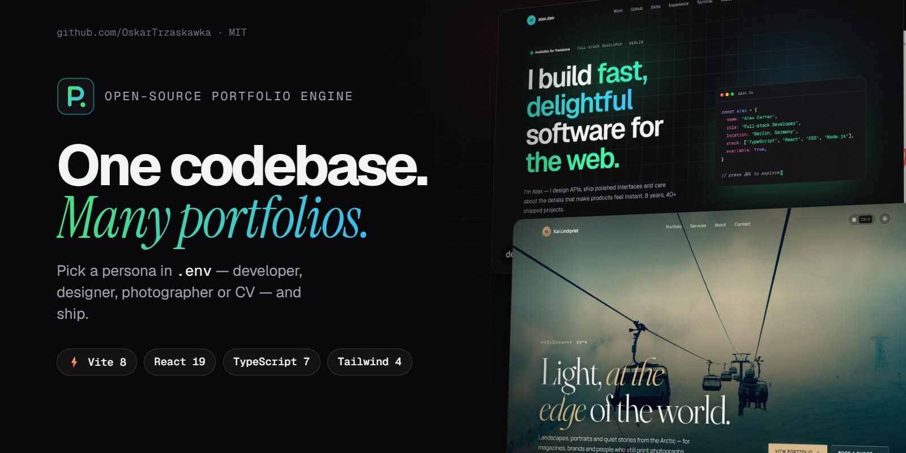

# Persona Folio

### One codebase. Many portfolios.

A config-driven, open-source portfolio engine for **developers, designers, photographers and writers**.<br/>
Pick a persona in `.env`, edit one typed data file, ship.

<!-- Repository -->
[](https://github.com/OskarTrzaskawka/persona-folio/stargazers)
[](https://github.com/OskarTrzaskawka/persona-folio/network/members)
[](https://github.com/OskarTrzaskawka/persona-folio/watchers)
[](https://discord.com/invite/U5fzuzbgkF)

<!-- Activity -->
[](https://github.com/OskarTrzaskawka/persona-folio/actions/workflows/ci.yml)
[](https://github.com/OskarTrzaskawka/persona-folio/actions/workflows/deploy.yml)
[](https://github.com/OskarTrzaskawka/persona-folio/issues)
[](https://github.com/OskarTrzaskawka/persona-folio/pulls)
[](https://github.com/OskarTrzaskawka/persona-folio/commits/main)
[](https://github.com/OskarTrzaskawka/persona-folio/graphs/contributors)
[](https://github.com/OskarTrzaskawka/persona-folio)
[](LICENSE)

<!-- Stack -->


**[Quick start](#-quick-start)** ·
**[Templates](#-templates)** ·
**[Configuration](#%EF%B8%8F-configuration-reference)** ·
**[Deploy](#-deploy)** ·
**[FAQ](#-faq)** ·
**[Discord](https://discord.com/invite/U5fzuzbgkF)**

</div>

> [!TIP]
> **Like it? Give the repo a ⭐.** It's free, takes one second, and helps other people find the project.

---

## 📑 Table of contents

- [Why Persona Folio?](#-why-persona-folio)
- [Templates](#-templates)
- [Features](#-features)
- [Quick start](#-quick-start)
- [Make it yours](#-make-it-yours)
- [Configuration reference](#%EF%B8%8F-configuration-reference)
- [Sections](#-sections)
- [Contact form setup](#-contact-form-setup)
- [Deploy](#-deploy)
- [Scripts](#-scripts)
- [Project structure](#-project-structure)
- [Tech stack](#-tech-stack)
- [FAQ](#-faq)
- [Troubleshooting](#-troubleshooting)
- [Roadmap](#-roadmap)
- [Contributing](#-contributing)
- [Support & community](#-support--community)
- [Star history](#-star-history)
- [License & credits](#-license--credits)

---

## 💡 Why Persona Folio?

Most portfolio templates give you **one** look. Persona Folio gives you a **portfolio engine**:

| | |
| --- | --- |
| 🎭 **4 templates, 1 codebase** | Developer, Designer, Photographer and Minimal/CV. Each has its own typography, hero, layout and light + dark palette. |
| 🧩 **14 composable sections** | Projects, live GitHub, gallery, terminal, experience, services, testimonials, stats, writing and more. Reorder freely. |
| ⚙️ **50+ `.env` options** | Name, socials, accent color, sections, feature flags and SEO, all without touching code. |
| 🗂 **Content as typed data** | One `.ts` file per persona, with autocomplete and type-checking in your editor. |
| 🪄 **Showcase mode** | Bundle every persona with a live switcher. Useful for a demo site or for choosing a look. |
| 🚀 **Deploy in minutes** | GitHub Pages workflow included. Works on Vercel, Netlify and Cloudflare Pages too. |

---

## 🎨 Templates

<div align="center">
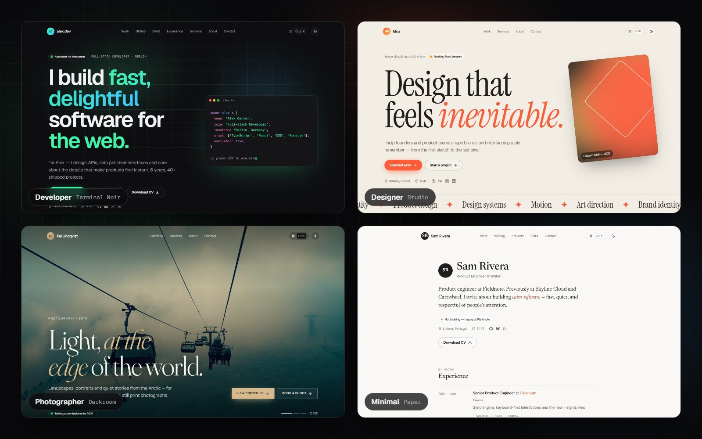
</div>

| Developer · *Terminal Noir* | Designer · *Studio* |
| :---: | :---: |
| 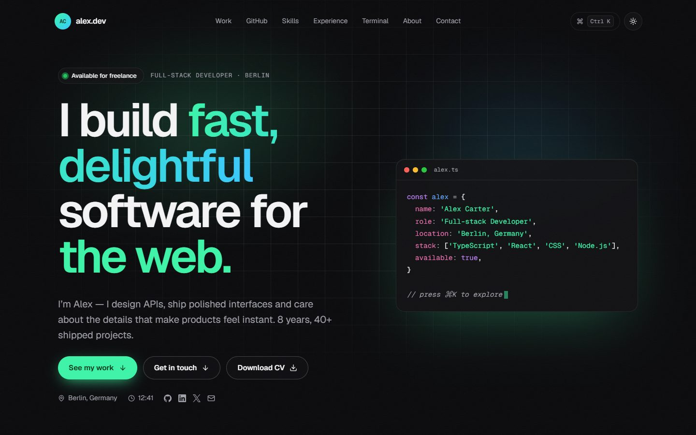 | 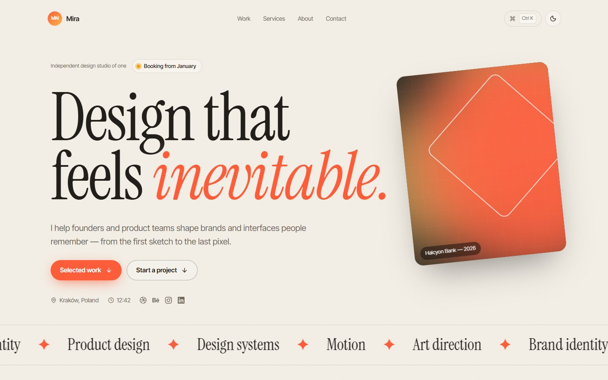 |
| Dark and technical. Live GitHub stats + contribution graph, interactive terminal, code-card hero. | Editorial serif type, generative artwork covers, bento grid, services & pricing. |
| **Photographer** · *Darkroom* | **Minimal** · *Paper* |
| 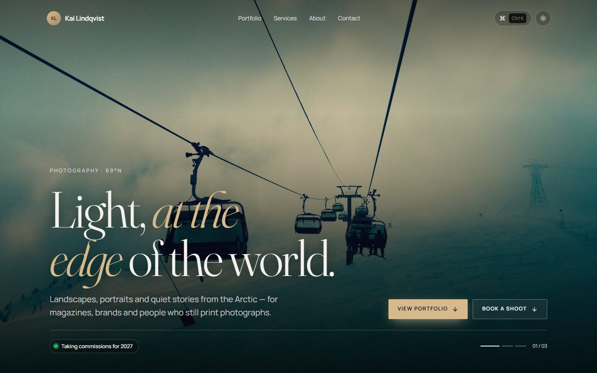 | 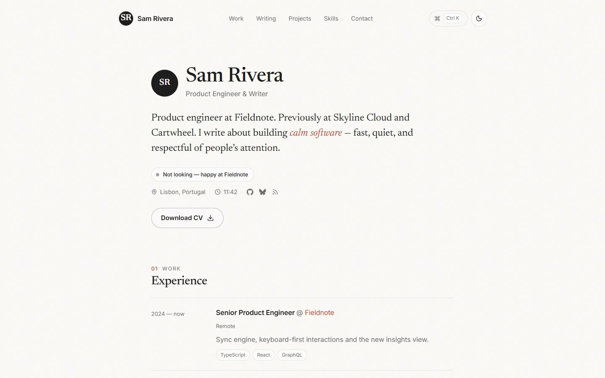 |
| Full-bleed Ken Burns slideshow, masonry gallery, swipeable keyboard lightbox. | Text-first résumé, writing list, print-ready stylesheet. |

Every template has both a **light and a dark** palette:

| Developer, light | Designer, dark | Photographer, light | Minimal, dark |
| :---: | :---: | :---: | :---: |
| 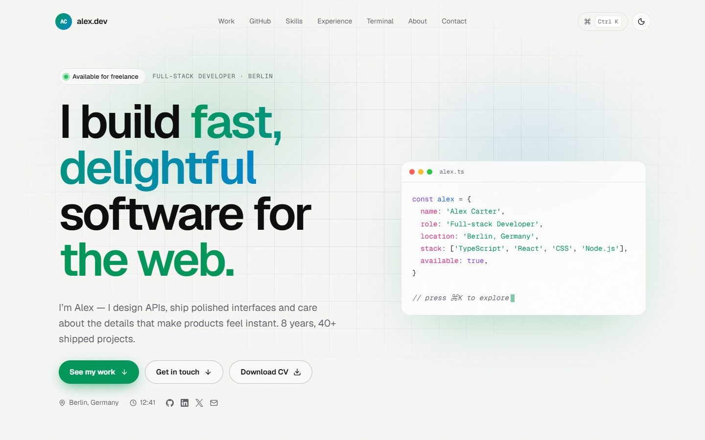 | 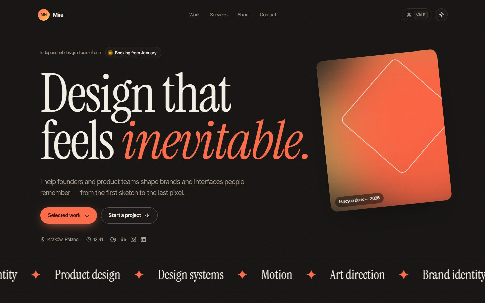 | 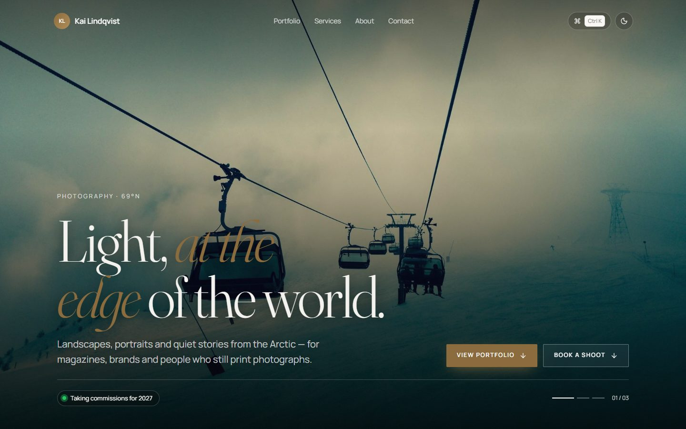 | 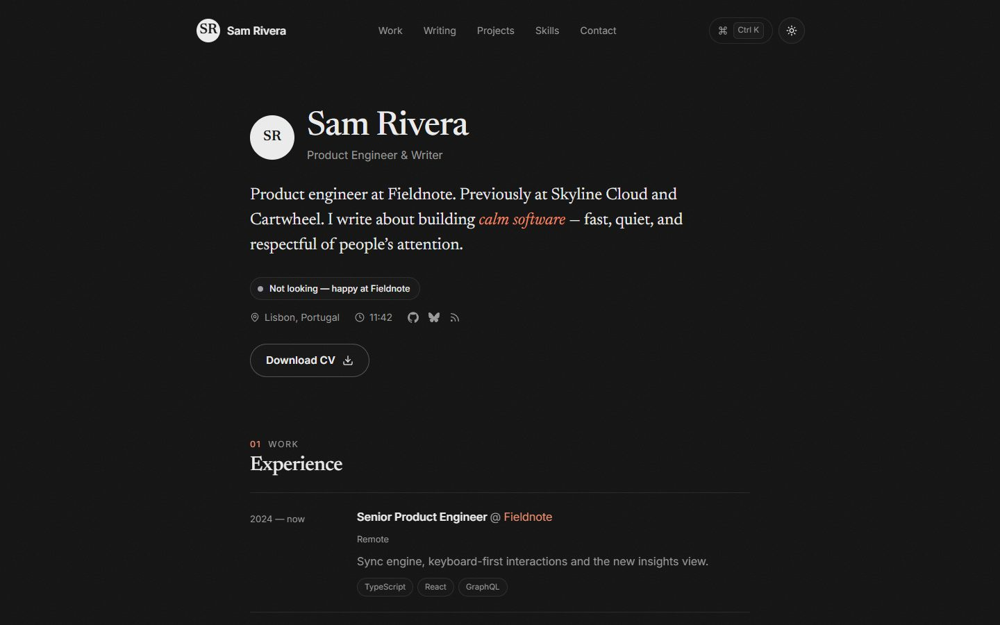 |

<details>
<summary><b>📱 Mobile screenshots</b></summary>
<br/>

| Developer | Designer | Photographer | Minimal |
| :---: | :---: | :---: | :---: |
| 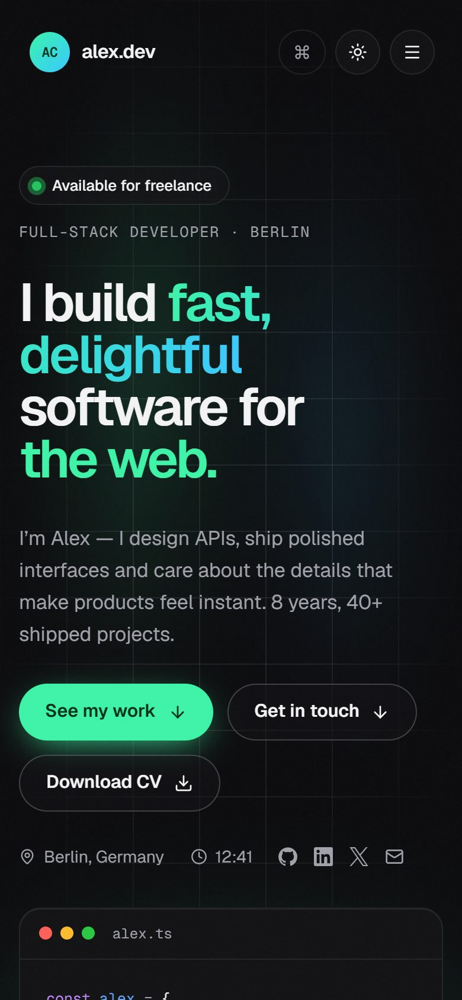 | 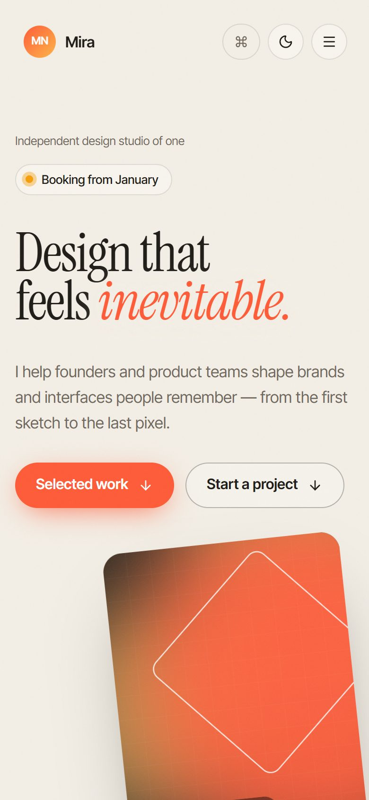 | 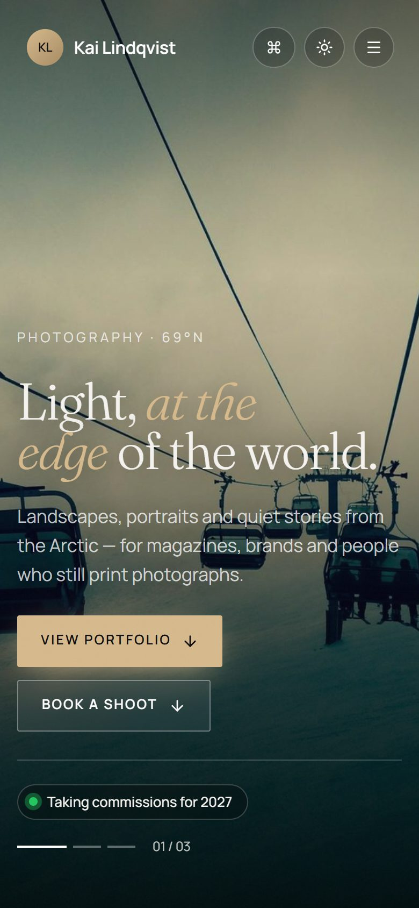 | 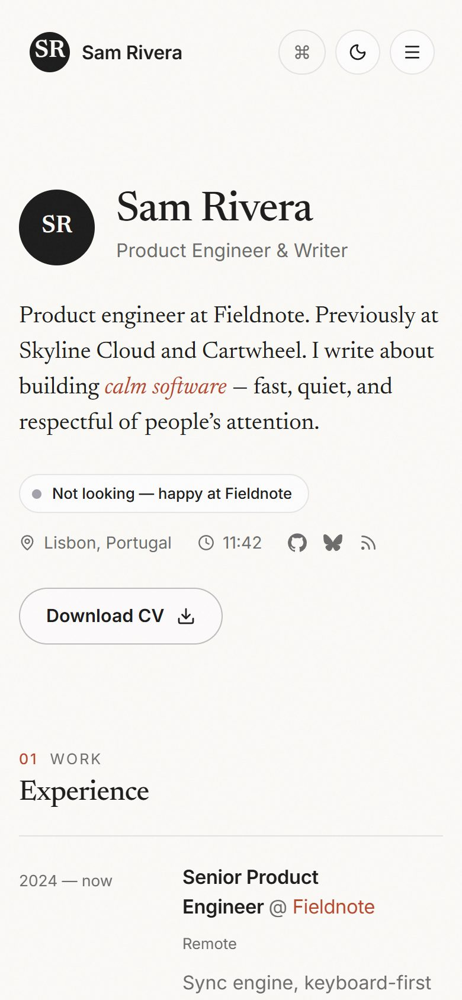 |

</details>

<details>
<summary><b>🖼 Full-page screenshots</b></summary>
<br/>

[Developer](docs/screenshots/developer-full.jpg) ·
[Designer](docs/screenshots/designer-full.jpg) ·
[Photographer](docs/screenshots/photographer-full.jpg) ·
[Minimal](docs/screenshots/minimal-full.jpg)

</details>

---

## ✨ Features

| ⌘K command palette | Case-study dialogs |
| :---: | :---: |
| 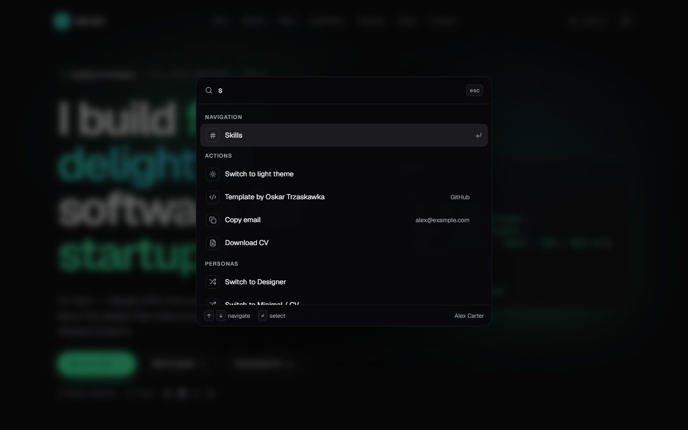 | 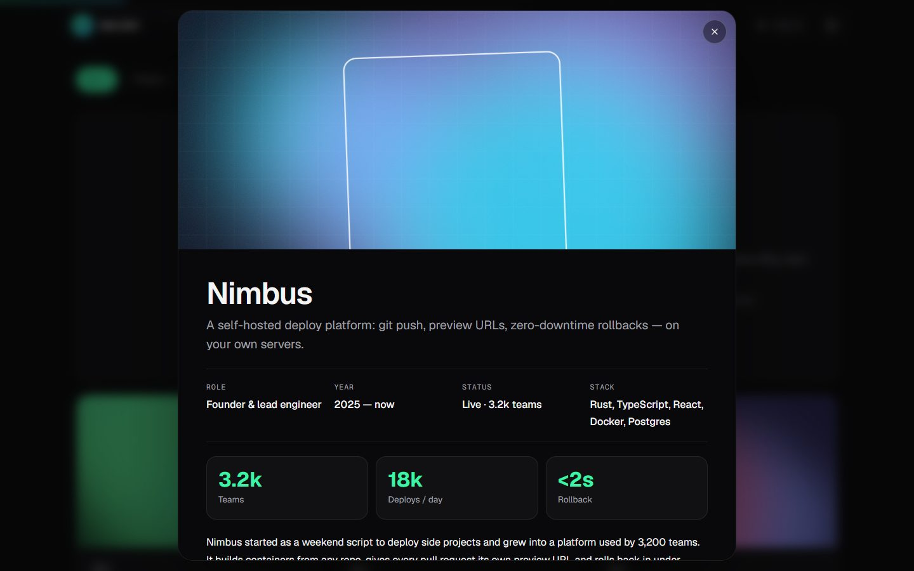 |
| **Interactive terminal** | **Gallery lightbox** |
| 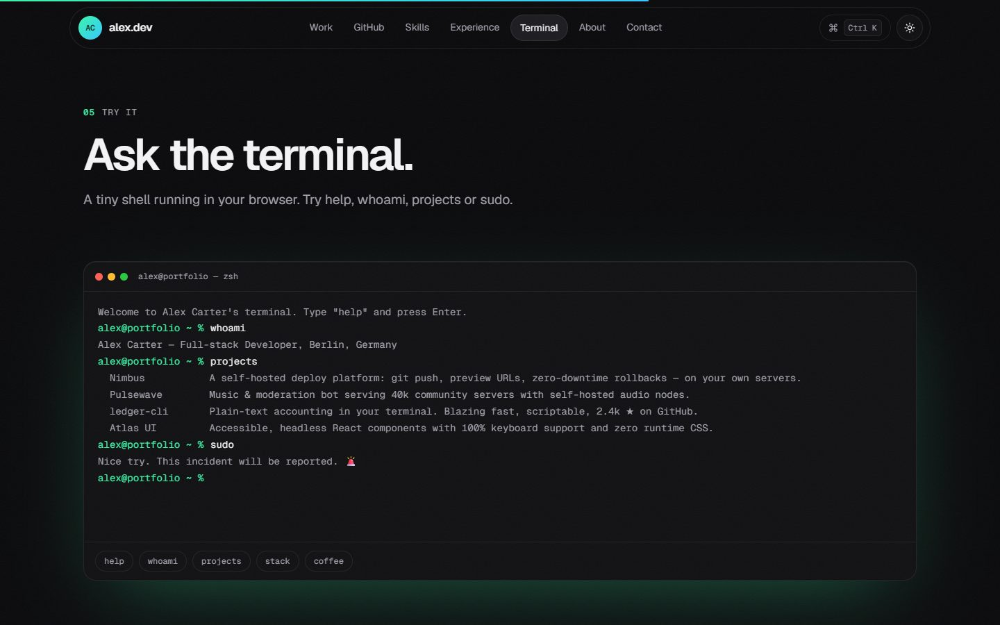 | 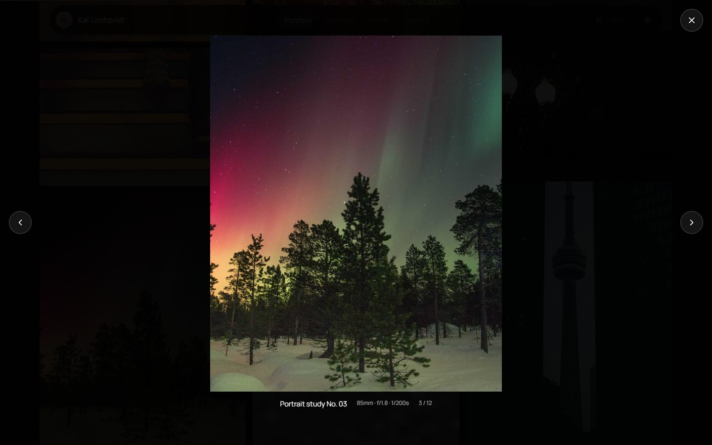 |

### Interaction
- ⌘K / Ctrl+K / `/` **command palette** with fuzzy search: navigate, switch theme, copy email, open links, switch persona
- 🌗 **Animated theme switch** as a circular reveal using the View Transitions API, with no flash of the wrong theme on load
- 🔍 Project **filters** with animated layout, plus **case-study dialogs** with metrics
- 💻 **Interactive terminal** with history (↑/↓), Tab completion and custom commands from config
- 🖼 **Masonry gallery** + lightbox with arrow-key and swipe navigation
- 📊 **Live GitHub**: repos, stars, followers, language breakdown and contribution heatmap (cached per session)
- 🕐 Live **local time**, **availability badge**, animated **stat counters**, **rotating headlines**
- ✉️ **Contact form** (Formspree, Web3Forms or any endpoint) with honeypot and a `mailto:` fallback
- 🎨 **Generative SVG covers.** Projects without images get a unique seeded artwork.

### Under the hood
- ⚡ **Vite 8** (Rolldown) · **React 19** (`use`, `useActionState`, Suspense) · **TypeScript 7** (native compiler) · **Tailwind CSS 4** · **Motion** · **Oxlint**
- 🎨 Modern CSS: `oklch()`, `color-mix()`, **scroll-driven animations** (`animation-timeline: scroll()`), `text-wrap: balance/pretty`, `field-sizing`, `interpolate-size`
- 🔎 **SEO generated at build time**: title, description, Open Graph, Twitter cards, canonical, JSON-LD `Person`, `sitemap.xml`, `robots.txt`, `manifest.webmanifest`
- ♿ **Accessible**: skip link, focus-visible styles, ARIA dialogs/listbox, full keyboard support, `prefers-reduced-motion` respected everywhere
- 🖨 **Print stylesheet**: print the Minimal persona straight to a CV
- 📦 **Code-split**: GitHub, gallery and terminal load only when a persona uses them
- 🍪 **No cookies, no trackers** by default. Optional cookieless Plausible/Umami
- 🤖 **CI/CD**: lint, typecheck and build every persona on each PR, plus automatic GitHub Pages deploys

---

## 🚀 Quick start

### Requirements

| Tool | Version | Check with |
| --- | --- | --- |
| [Node.js](https://nodejs.org) | **22 or newer** (24 LTS recommended) | `node -v` |
| npm | 10+ (ships with Node) | `npm -v` |
| Git | any recent version | `git --version` |

### 1. Get the code

**Option A: GitHub template (recommended).** Click **“Use this template” → “Create a new repository”** at the top of this page. You get a clean copy under your own account.

**Option B: clone it**

```bash
git clone https://github.com/OskarTrzaskawka/persona-folio.git my-portfolio
cd my-portfolio
```

### 2. Install dependencies

```bash
npm install
```

### 3. Create your `.env`

```bash
# macOS / Linux / Git Bash
cp .env.example .env

# Windows PowerShell
Copy-Item .env.example .env
```

### 4. Start the dev server

```bash
npm run dev                 # developer persona (default)
npm run dev:designer        # designer
npm run dev:photographer    # photographer
npm run dev:minimal         # minimal / CV
npx vite --mode showcase    # every persona + floating switcher
```

Open **http://localhost:5173**, then try:

- **Ctrl+K** (⌘K on macOS) to open the command palette
- the ☀️/🌙 button to switch theme
- a project card to open its case study
- `help` in the terminal (developer persona)

Changes to `src/personas/*.ts` and `.env` show up instantly. Restart the dev server after editing `.env`.

### 5. Build for production

```bash
npm run build      # typecheck + build into dist/
npm run preview    # serve dist/ locally at http://localhost:4173
```

The `dist/` folder is a fully static site. Upload it anywhere.

---

## 🛠 Make it yours

### Option A: only `.env` (about 2 minutes)

Keep a demo persona and override what you need:

```ini
VITE_PERSONA=developer
VITE_NAME=Jane Doe
VITE_ROLE=Frontend Engineer
VITE_EMAIL=jane@example.com
VITE_LOCATION=Warsaw, Poland
VITE_TIMEZONE=Europe/Warsaw
VITE_AVATAR_URL=/me.jpg            # put me.jpg in /public
VITE_GITHUB_USERNAME=janedoe       # powers the live GitHub section
VITE_LINKEDIN_URL=https://linkedin.com/in/janedoe
VITE_ACCENT_COLOR=#7c3aed
VITE_HIDE_SECTIONS=testimonials,stats
VITE_SITE_URL=https://janedoe.dev
```

### Option B: your own persona file (full control)

```bash
npm run new-persona -- jane designer   # copies the designer demo to src/personas/jane.ts
npx vite --mode jane                    # preview it
```

Then edit `src/personas/jane.ts`. It is fully typed, so your editor autocompletes every field:

```ts
import { definePersona } from '../core/define'

export default definePersona({
  id: 'jane',
  label: 'Jane',
  template: 'designer',          // developer | designer | photographer | minimal
  defaultScheme: 'light',        // dark | light | system
  theme: { accent: 'oklch(0.7 0.2 30)' },
  meta: { title: 'Jane Doe — Designer', description: 'Brand & product designer.' },
  person: { name: 'Jane Doe', role: 'Designer', email: 'jane@example.com', avatar: '/me.jpg' },
  socials: [{ label: 'Dribbble', href: 'https://dribbble.com/jane', icon: 'dribbble' }],
  hero: { title: 'Design that\nfeels *inevitable.*', subtitle: 'I design brands people remember.' },
  sections: [
    { type: 'projects', title: 'Work', layout: 'bento', filters: true, items: [/* … */] },
    { type: 'services', title: 'Services', items: [/* … */] },
    { type: 'contact', title: 'Say hi', text: 'I reply within 24h.', form: true },
  ],
})
```

Set `VITE_PERSONA=jane` in `.env` and it becomes your default.

> [!NOTE]
> - Put images in `public/` and reference them as `/my-image.jpg`.
> - Wrap words in `*asterisks*` to highlight them, and use `\n` for line breaks in titles.
> - Any template works with any content. Try `VITE_TEMPLATE=photographer` on the developer persona.

---

## ⚙️ Configuration reference

All variables are optional. Empty means the value from the persona file is used. The full annotated list is in [`.env.example`](.env.example).

> [!WARNING]
> Every `VITE_*` variable is **public**: it is compiled into the JavaScript bundle. Never put secrets, API keys or tokens in it.

<details open>
<summary><b>🎭 Persona & look</b></summary>

| Variable | Default | Description |
| --- | --- | --- |
| `VITE_PERSONA` | `developer` | File in `src/personas/` to build |
| `VITE_TEMPLATE` | from persona | Force a template: `developer` `designer` `photographer` `minimal` |
| `VITE_DEFAULT_SCHEME` | from template | `dark` `light` `system` |
| `VITE_ACCENT_COLOR` | from template | Any CSS color (`#hex`, `oklch()`, `rebeccapurple`…) |
| `VITE_ACCENT_COLOR_2` | from template | Secondary accent (gradients, meters) |
| `VITE_SHOWCASE` | `false` | Bundle all personas and show the switcher |

</details>

<details>
<summary><b>👤 Identity & hero</b></summary>

| Variable | Description |
| --- | --- |
| `VITE_NAME` | Full name |
| `VITE_SHORT_NAME` | Name in the nav (defaults to `VITE_NAME`) |
| `VITE_ROLE` | Job title |
| `VITE_LOCATION` | City, country |
| `VITE_TIMEZONE` | IANA zone for the live clock, e.g. `Europe/Warsaw` |
| `VITE_EMAIL` | Contact email (enables copy button + form) |
| `VITE_AVATAR_URL` | `/me.jpg` or a URL. Empty uses generated initials |
| `VITE_RESUME_URL` | Adds a "Download CV" button, e.g. `/cv.pdf` |
| `VITE_AVAILABILITY` | `open` `limited` `closed` `hidden` |
| `VITE_AVAILABILITY_LABEL` | Badge text, e.g. "Available for freelance" |
| `VITE_HERO_TITLE` | Hero headline (`*highlight*`, `\n`) |
| `VITE_HERO_SUBTITLE` | Hero paragraph |

</details>

<details>
<summary><b>🔗 Social links</b></summary>

| Variable | Notes |
| --- | --- |
| `VITE_GITHUB_USERNAME` | Also powers the live GitHub section |
| `VITE_LINKEDIN_URL` · `VITE_X_URL` · `VITE_BLUESKY_URL` · `VITE_MASTODON_URL` | Full URLs |
| `VITE_INSTAGRAM_URL` · `VITE_DRIBBBLE_URL` · `VITE_BEHANCE_URL` | Full URLs |
| `VITE_YOUTUBE_URL` · `VITE_VIMEO_URL` · `VITE_DISCORD_URL` · `VITE_MEDIUM_URL` · `VITE_FACEBOOK_URL` | Full URLs |

A URL replaces the persona's link with the same icon, or is added if missing.

</details>

<details>
<summary><b>🧩 Sections & features</b></summary>

| Variable | Default | Description |
| --- | --- | --- |
| `VITE_HIDE_SECTIONS` | | Comma list of section types/ids to hide |
| `VITE_SECTION_ORDER` | | Comma list; unlisted sections keep their order after |
| `VITE_FEATURE_COMMAND_PALETTE` | `true` | ⌘K palette |
| `VITE_FEATURE_THEME_TOGGLE` | `true` | Light/dark button |
| `VITE_FEATURE_SCROLL_PROGRESS` | `true` | Top progress bar |
| `VITE_FEATURE_CURSOR_GLOW` | `true` | Pointer spotlight |
| `VITE_FEATURE_ANIMATIONS` | `true` | All motion (reduced motion is always respected) |
| `VITE_FEATURE_CONTACT_FORM` | `true` | Form in the contact section |
| `VITE_FEATURE_LOCAL_TIME` | `true` | Live clock |
| `VITE_FEATURE_BACK_TO_TOP` | `true` | Floating button |
| `VITE_FEATURE_GRAIN` | `true` | Film-grain overlay (designer / photographer) |

</details>

<details>
<summary><b>🔎 SEO, deploy & integrations</b></summary>

| Variable | Description |
| --- | --- |
| `VITE_SITE_URL` | Public URL. Enables canonical, `og:url` and `sitemap.xml` |
| `VITE_SITE_TITLE` | Override `<title>` |
| `VITE_SITE_DESCRIPTION` | Override meta description |
| `VITE_OG_IMAGE` | 1200×630 social preview image |
| `VITE_BASE` | Sub-path for GitHub Pages project sites (`/repo/`) |
| `VITE_CONTACT_ENDPOINT` | Form endpoint (Formspree, Web3Forms, Getform…) |
| `VITE_CONTACT_ACCESS_KEY` | Public form key (Web3Forms `access_key`) |
| `VITE_PLAUSIBLE_DOMAIN` | Cookieless Plausible analytics |
| `VITE_UMAMI_WEBSITE_ID` · `VITE_UMAMI_SRC` | Cookieless Umami analytics |

</details>

---

## 🧩 Sections

| Type | What it renders | Notable options |
| --- | --- | --- |
| `projects` | Project grid + case-study dialog | `layout: cards \| bento \| spotlight \| list`, `filters`, `metrics`, `art` |
| `github` | Live repos, stars, languages, heatmap | `username`, `limit`, `contributions`, `languages`, `exclude` |
| `gallery` | Masonry/grid + lightbox | `layout`, `filters`, per-image `exif` |
| `terminal` | Interactive shell | `prompt`, custom `commands` |
| `skills` | Meters, tags or columns | `variant`, `groups` |
| `experience` | Career timeline | `tags`, `href` |
| `services` | Service cards with pricing | `icon`, `price`, `bullets` |
| `process` | Numbered steps | |
| `testimonials` | Quote cards | `avatar` (or generated initials) |
| `stats` | Animated counters | `prefix`, `suffix` |
| `marquee` | Infinite ticker | |
| `writing` | Blog / essay list | `readTime`, `tag` |
| `about` | Bio + facts | optional `image` |
| `contact` | Headline, links, form | `rotating`, `form` |

Every section accepts `id`, `nav` (label or `false` to hide from the menu), `eyebrow`, `title` and `intro`.

---

## ✉️ Contact form setup

| Mode | How it works |
| --- | --- |
| **No config** (default) | "Send" opens the visitor's mail app with a pre-filled email to `VITE_EMAIL`. |
| **Formspree** | Create a form at [formspree.io](https://formspree.io) and set `VITE_CONTACT_ENDPOINT=https://formspree.io/f/xxxxxxx`. |
| **Web3Forms** | Get a key at [web3forms.com](https://web3forms.com), set `VITE_CONTACT_ENDPOINT=https://api.web3forms.com/submit` and `VITE_CONTACT_ACCESS_KEY=your-key`. |
| **Anything else** | Any endpoint that accepts a `multipart/form-data` POST with `name`, `email` and `message`. |

With an endpoint, messages are sent in the background and the visitor sees a thank-you state. A hidden honeypot field (`_gotcha`) filters out basic bots.

---

## 🌍 Deploy

### GitHub Pages (workflow included)

1. Push the repo to GitHub (branch `main`).
2. **Settings → Pages → Build and deployment → Source: GitHub Actions**.
3. *(Optional)* **Settings → Secrets and variables → Actions → Variables**: add `VITE_PERSONA`, `VITE_NAME`, `VITE_GITHUB_USERNAME`… (same names as `.env`).
4. Push. Your site goes live at `https://<you>.github.io/<repo>/`. The base path is detected automatically.

### Vercel · Netlify · Cloudflare Pages

| Setting | Value |
| --- | --- |
| Build command | `npm run build` |
| Output directory | `dist` |
| Node version | 22+ |
| Environment variables | your `VITE_*` values |

### Live demo with every persona

Set the variable `VITE_SHOWCASE=true` (or run `npm run build:showcase`). Visitors can then switch personas from the floating dock or with `?persona=designer` in the URL.

---

## 📜 Scripts

| Command | Description |
| --- | --- |
| `npm run dev` | Dev server (developer persona) |
| `npm run dev:designer` · `dev:photographer` · `dev:minimal` | Dev server for a demo persona |
| `npx vite --mode <persona>` | Dev server for any persona with a `.env.<persona>` file |
| `npm run build` | Typecheck + production build |
| `npm run build:showcase` | Build with every persona + switcher |
| `npm run preview` | Serve the production build |
| `npm run lint` | Oxlint |
| `npm run typecheck` | TypeScript 7 |
| `npm run new-persona -- <id> [template]` | Scaffold a new persona |
| `npm run screenshots` | Regenerate `docs/screenshots` (uses installed Chrome/Edge) |
| `npm run banner` | Regenerate `docs/banner.jpg`, `social-preview.jpg`, `templates.jpg` |

---

## 🗂 Project structure

```
persona-folio/
├── .github/                  CI, Pages deploy, issue & PR templates
├── docs/                     README graphics & screenshots
├── plugins/persona.ts        Vite plugin: persona resolution, SEO tags, sitemap, manifest
├── public/                   Static files (put your images here)
├── scripts/                  new-persona, screenshots and banner CLIs
├── src/
│   ├── personas/             ← your content lives here (one file per portfolio)
│   │   ├── developer.ts
│   │   ├── designer.ts
│   │   ├── photographer.ts
│   │   └── minimal.ts
│   ├── core/                 schema, .env overrides, store, templates, hooks, UI strings
│   ├── components/           hero variants, nav, footer, command palette, primitives
│   ├── sections/             section components + registry
│   └── styles/               Tailwind entry + template tokens
├── .env.example              every option, documented
└── index.html
```

---

## 🧰 Tech stack

| Area | Choice |
| --- | --- |
| Build | [Vite 8](https://vite.dev) (Rolldown) |
| UI | [React 19](https://react.dev) |
| Language | [TypeScript 7](https://www.typescriptlang.org) (native compiler) |
| Styling | [Tailwind CSS 4](https://tailwindcss.com) + modern CSS custom properties |
| Animation | [Motion](https://motion.dev) + View Transitions API + CSS scroll-driven animations |
| Icons | [Lucide](https://lucide.dev) + [Simple Icons](https://simpleicons.org) |
| Lint | [Oxlint](https://oxc.rs) |
| Screenshots | [Playwright](https://playwright.dev) (core, with your installed browser) |

---

## ❓ FAQ

<details>
<summary><b>Do I need to know React to use this?</b></summary>

No. For most people, editing `.env` and one persona file (plain data) is enough. React knowledge only matters if you want to add new sections or templates.
</details>

<details>
<summary><b>Can I mix a template with different content?</b></summary>

Yes. Templates and content are independent. Set `template: 'photographer'` in any persona, or `VITE_TEMPLATE=photographer` in `.env`.
</details>

<details>
<summary><b>Is there a backend? Does it cost anything to host?</b></summary>

No backend. It is a static site, so GitHub Pages, Netlify, Vercel and Cloudflare Pages all host it for free.
</details>

<details>
<summary><b>Does the GitHub section need a token?</b></summary>

No. It uses the public, unauthenticated GitHub API (60 requests/hour per visitor IP) and caches results for an hour per session. Never put a token in `VITE_*`. It would be public.
</details>

<details>
<summary><b>Do I need a cookie banner?</b></summary>

Not by default. The site sets no cookies and only stores the theme preference in `localStorage`. Plausible and Umami are cookieless too. Check your local laws if you add other tools.
</details>

<details>
<summary><b>Can I use it for commercial / client work?</b></summary>

Yes. It is MIT licensed. Keep the license file. Keeping the footer credit is appreciated but not required.
</details>

---

## 🩺 Troubleshooting

| Problem | Fix |
| --- | --- |
| `VITE_PERSONA="x" not found` | The file `src/personas/x.ts` doesn't exist. Run `npm run new-persona -- x`. |
| `.env` changes don't apply | Restart `npm run dev`. Vite reads env files on startup. |
| Blank page / 404s on GitHub Pages | Use the included workflow (it sets `VITE_BASE`), or set `VITE_BASE=/<repo>/` yourself. |
| GitHub section says "not responding" | API rate limit (60 req/h per IP) or network issue. It recovers on its own. |
| Fonts look wrong offline | Fonts load from Google Fonts. Self-host them in `public/` if you need offline support. |
| `npm run screenshots` fails | It uses your installed Edge (Windows) or Chrome. Set `BROWSER_CHANNEL=chrome` or `chromium`. |
| Node errors on install | Use Node.js 22 or newer (`node -v`). |

Still stuck? Ask on **[Discord](https://discord.com/invite/U5fzuzbgkF)** or [open an issue](https://github.com/OskarTrzaskawka/persona-folio/issues/new/choose).

---

## 🗺 Roadmap

- [x] 4 templates with light/dark palettes
- [x] 14 section types, command palette, live GitHub, terminal, lightbox
- [x] 50+ `.env` options, SEO plugin, GitHub Pages workflow
- [ ] More templates: musician, architect, 3D artist, video creator
- [ ] Markdown/MDX blog posts for the `writing` section
- [ ] Multi-language content
- [ ] Visual persona editor
- [ ] Automatic Open Graph image generation per persona

Have an idea? [Open a feature request](https://github.com/OskarTrzaskawka/persona-folio/issues/new/choose) or vote with 👍 on existing ones.

---

## 🤝 Contributing

New templates, sections and persona presets are very welcome. Read [CONTRIBUTING.md](CONTRIBUTING.md) to get started, then:

```bash
git checkout -b feat/my-idea
npm run lint && npm run typecheck
git commit -m "feat: add musician template"
```

…and open a pull request. 💚

---

## 💬 Support & community

<div align="center">

[](https://discord.com/invite/U5fzuzbgkF)

</div>

- 💬 **Questions & help:** [Discord support server](https://discord.com/invite/U5fzuzbgkF)
- 🐞 **Bugs:** [GitHub issues](https://github.com/OskarTrzaskawka/persona-folio/issues/new/choose)
- 💡 **Ideas:** feature requests or the Discord
- ⭐ **Show love:** star the repo and share your portfolio on Discord

---

## 📈 Star history

<a href="https://star-history.com/#OskarTrzaskawka/persona-folio&Date">
  <picture>
    <source media="(prefers-color-scheme: dark)" srcset="https://api.star-history.com/svg?repos=OskarTrzaskawka/persona-folio&type=Date&theme=dark" />
    <source media="(prefers-color-scheme: light)" srcset="https://api.star-history.com/svg?repos=OskarTrzaskawka/persona-folio&type=Date" />
    
  </picture>
</a>

---

## 📄 License & credits

Released under the [MIT License](LICENSE).<br/>
**© 2026 [Oskar Trzaskawka](https://github.com/OskarTrzaskawka)**. Created and maintained by Oskar Trzaskawka.

- Demo personas, names, companies and numbers are **fictional**.
- Demo photos via [picsum.photos](https://picsum.photos) (Unsplash License).
- Brand icons by [Simple Icons](https://simpleicons.org) (CC0), UI icons by [Lucide](https://lucide.dev) (ISC).

<div align="center">
<br/>

**If Persona Folio helped you, please ⭐ the repo. Thank you!**

Made with 💚 by [Oskar Trzaskawka](https://github.com/OskarTrzaskawka) · [Discord](https://discord.com/invite/U5fzuzbgkF)

</div>
